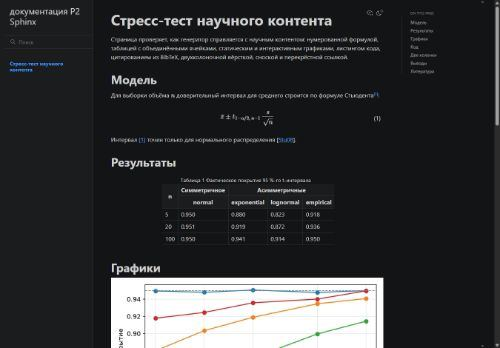
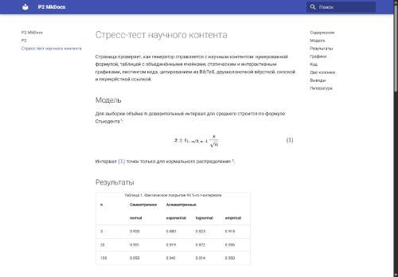
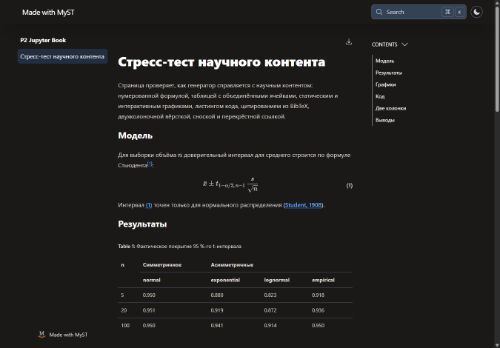
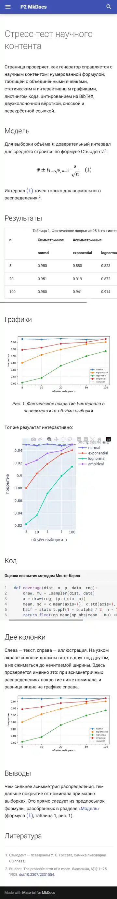

# P2. Страница — стресс-тест научного контента

Одна и та же страница свёрстана на трёх генераторах из T1: **Sphinx + MyST**, **MkDocs Material**
и **Jupyter Book 2**. Содержание и данные одинаковые — результаты T2. Различается только разметка:
у каждого генератора она родная.

## Методика

**Состав страницы:**
- нумерованная формула со ссылкой из текста;
- таблица с объединёнными ячейками и подписью;
- статический график matplotlib и интерактивный Plotly;
- листинг с подсветкой и номерами строк;
- цитата из `.bib` и список литературы;
- двухколоночный блок;
- сноска и перекрёстная ссылка на раздел.

**Настройки «как в документации».** Каждый генератор настроен так, как рекомендует его собственная
документация. Где она предлагает CDN, используется CDN: MathJax у Sphinx и Material, шрифты Google
у Material, Plotly со своего CDN у всех. Поэтому столбец «внешние запросы» показывает, с чем
генератор приходит по умолчанию. Как от этого уйти, разобрано в T4; наш сайт работает без CDN.

**Замеры.**
- **Время сборки** — медиана трёх холодных сборок проекта из одной страницы.
- **Вес, запросы, оценки** — Lighthouse 13.5 в Chrome 155: мобильный режим (эмуляция смартфона, 412 px)
  и настольный. Локальные файлы отдавались сервером с gzip, как это делают GitHub Pages и Helios.
  Иначе свои файлы весили бы в разы больше сжатых CDN-ресурсов и сравнение было бы нечестным.
- **Мобильная вёрстка** — проверка в браузере на ширине 412 px: есть ли горизонтальная прокрутка
  страницы, не выходят ли элементы за экран, встают ли колонки друг под друга. Плюс скриншоты.

**Оговорки по стенду.**
- Антивирус на машине замера внедряет в каждую страницу свой скрипт (`kaspersky-labs.com`,
  150–300 КБ). Из веса и запросов он исключён, но на время загрузки и оценку производительности
  влияет одинаково для всех трёх страниц.
- Пункт `is-on-https` в «Практиках» проваливают все три страницы, потому что замер шёл по
  локальному `http`. Это свойство стенда, а не генераторов.

Скрипты: [`research/p2`](https://github.com/crasavella04/python-lab3/tree/main/research/p2) —
`make_assets.py` (графики и данные), `make_sites.py` (три проекта), `bench_p2.py` (сборка),
`gzip_server.py`, `parse_lighthouse.py`.

## Результаты

| | Sphinx + MyST | MkDocs Material | Jupyter Book 2 |
|---|---:|---:|---:|
| Время сборки (холодная, 1 страница) | 7,1 с | **2,4 с** | 52,6 с |
| Вес страницы | 2,1 МБ | 2,1 МБ | 3,5 МБ |
| — без библиотеки Plotly (1 439 КБ, одинакова у всех) | 0,69 МБ | **0,66 МБ** | 2,04 МБ |
| Запросов всего | **21** | 26 | 36 |
| Из них внешних | 8 | 16 | **6** |
| Внешние хосты | `cdn.jsdelivr.net`, `cdn.plot.ly` | `fonts.googleapis.com`, `fonts.gstatic.com`, `unpkg.com`, `cdn.plot.ly` | `cdn.jsdelivr.net`, `cdnjs.cloudflare.com`, `cdn.plot.ly` |
| **Lighthouse, мобильный:** производительность | **57** | 31 | 17 |
| доступность | **95** | 87 | 92 |
| практики | 77 | **81** | **81** |
| SEO | 91 | 91 | **92** |
| **Lighthouse, настольный:** производительность | 61 | **70** | 48 |
| доступность | 92 | 87 | **96** |
| Первая отрисовка / крупнейший элемент, мобильный | **2,3 / 2,9 с** | 3,4 / 16,7 с | 11,8 / 12,3 с |
| Мобильный: горизонтальная прокрутка страницы | нет | нет | нет |
| Мобильный: дефекты | — | — | **график Plotly в iframe обрезан** |

Что видно из таблицы:

- **Plotly — самая тяжёлая часть страницы у всех трёх**: 1 439 КБ в gzip, две трети веса страницы
  на Sphinx и MkDocs. Один интерактивный график весит больше, чем весь остальной сайт. T1 оценивал
  это в 1,45 МБ, здесь замер подтвердился.
- **Без Plotly Sphinx и MkDocs примерно равны** (0,66–0,69 МБ). Jupyter Book втрое тяжелее: 2 МБ
  собственного JavaScript темы на React и движка Thebe для живых вычислений.
- **Производительность на мобильном** решают внешние ресурсы и JavaScript.
  - MkDocs проигрывает Sphinx (31 против 57): Google Fonts блокируют отрисовку (T4), а крупнейший
    элемент появляется через 16,7 с.
  - Jupyter Book первый раз рисует страницу только через 11,8 с: страница собирается в браузере
    из JavaScript.
  - На настольном MkDocs лидирует (70): быстрая сеть сглаживает загрузку шрифтов.
- **Мобильная вёрстка корректна у всех трёх.** Таблицы шире экрана (465 px у Sphinx, 525 px у
  MkDocs) обёрнуты в контейнер с прокруткой, страница целиком не прокручивается вбок, колонки
  встают друг под друга. Единственный визуальный дефект — обрезанный график у Jupyter Book: DOM-проверки
  его не видят, он заметен только на скриншоте.

## Скриншоты

Первый экран на настольном (1350 px) и мобильном (412 px), из отчётов Lighthouse:

::::{grid} 1 1 3 3
:::{grid-item}
**Sphinx + MyST**

:::
:::{grid-item}
**MkDocs Material**

:::
:::{grid-item}
**Jupyter Book 2**

:::
::::

Вся страница на мобильном (уменьшено до 360 px):

::::{grid} 1 3 3 3
:::{grid-item}
**Sphinx + MyST**

:::
:::{grid-item}
**MkDocs Material**

:::
:::{grid-item}
**Jupyter Book 2**

:::
::::

## Что потребовало обходных путей и какой ценой

✔ — штатно; **плагин** — нужен сторонний пакет; **ручной HTML / код** — вставка разметки или
своего кода; ✘ — не удалось полноценно.

| Элемент | Sphinx + MyST | MkDocs Material | Jupyter Book 2 |
|---|---|---|---|
| Нумерованная формула и ссылка | ✔ `$$ … $$ (eq-ci)`, `{eq}` | **свой JS**: конфигурация MathJax с `tags: 'ams'`, `\label`/`\eqref`; ссылки только в пределах страницы | ✔ `` |
| Таблица с объединёнными ячейками | **вставка rST**: grid-таблица в `{eval-rst}`; MyST-таблицы объединений не знают | **ручной HTML** `<table>` с `rowspan`/`colspan`; подпись и номер «Таблица 1» написаны вручную | **ручной HTML** внутри `{table}`: mystmd разобрал его и пронумеровал |
| Подпись и номер таблицы/рисунка | ✔ «Таблица 1», «Рис. 1» | **вручную**: `pymdownx.blocks.caption`, номер текстом | ✔, но **по-английски**: «Table 1:», «Figure 1:», в ссылках — «таблица Table 1» |
| Статический график | ✔ `{figure}` | ✔ | ✔ |
| Интерактивный Plotly | **ручной HTML** (`{raw} html`) | **ручной HTML** | ✘ **частично**: `{iframe}` не копирует локальный HTML (404), `project.resources` не помог. HTML графика пришлось класть в сборку вручную, а на мобильном iframe обрезает график |
| Подсветка и номера строк | ✔ `:linenos:`; в подписи нет пробела: «Список 1Оценка…» | ✔ `linenums`; номера строк сделаны таблицей, и Lighthouse снимает за неё баллы доступности (`table-fake-caption`) | ✔ `:linenos:` |
| Цитата и список литературы | **плагин** `sphinxcontrib-bibtex`; стиль переводит заголовок в нижний регистр: «The probable error of a mean» | **плагин** `mkdocs-bibtex`: источник становится **сноской** в общей нумерации со сносками; отдельного списка нет, маркер `\bibliography` молча исчезает | ✔ штатно, APA, регистр заголовка сохранён |
| Две колонки | **плагин** `sphinx-design` | ✔ сетка Material (`
`) | ✔ `{grid}` |
| Сноска, ссылка на раздел | ✔ | ✔ | ✔ |
| Язык интерфейса | ✔ русский | ✔ русский | ✘ английский: «Contents», «Footnotes», «References»; язык проекта mystmd игнорирует (T1) |
| Прочее | нет `favicon.ico` → 404 в консоли, «Практики» 77 вместо 81 (одна строка `html_favicon`) | — | сборка 52,6 с: тема поднимает Node-сервер; при новом проекте заново скачивается шаблон темы на 125 МБ |

## Вывод

**Sphinx + MyST** — лучший баланс для научной страницы: лучшая мобильная производительность и
доступность, всё научное (нумерация, подписи, ссылки по номеру, библиография) штатно или через
стандартные расширения. Платить пришлось вставкой rST ради объединённых ячеек и двумя плагинами.
Это подтверждает вывод T1.

**MkDocs Material** — самый быстрый в сборке и самый лёгкий без Plotly. Но научный аппарат
собирается вручную: нумерацию формул обеспечивает конфигурация MathJax, номера таблиц и рисунков
пишутся текстом, а библиография превращается в сноски. На мобильном его тормозят Google Fonts.

**Jupyter Book 2** — лучший научный аппарат «из коробки»: формулы, таблица из HTML, библиография
по APA, всё пронумеровано. Но страница втрое тяжелее и рисуется на мобильном за 12 секунд.
Интерактивный HTML штатно не встраивается, а интерфейс и подписи — только по-английски. Для
русскоязычной публикации последнее заметнее всего.

Общее для всех: **интерактивный график стоит больше, чем вся остальная страница.** Если без
интерактивности можно обойтись, статический график в 52 КБ лучше. Если нельзя — стоит брать
частичную сборку Plotly или Altair, который легче в 4,5 раза (T1).
