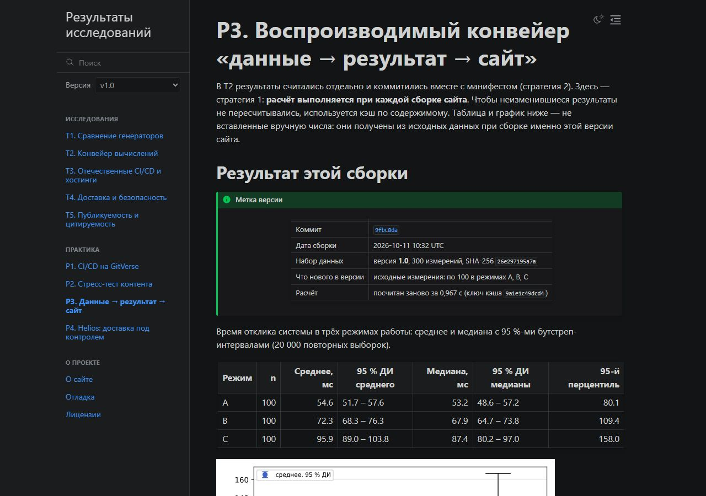
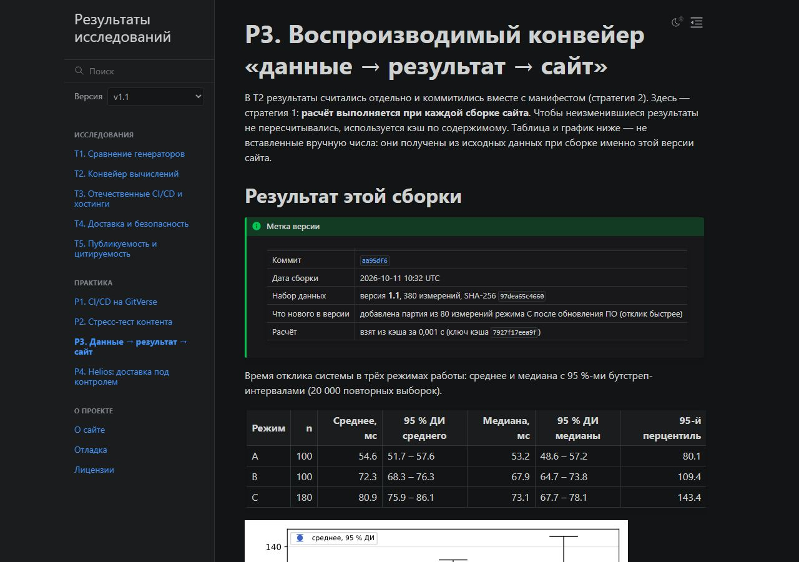

# P5. Версионирование опубликованных результатов

Результаты исследования меняются: появляются новые данные, исправляется код. Читатель, который
сослался на таблицу полгода назад, должен найти по ссылке ту же таблицу, а не нынешнюю. Для этого
у сайта теперь есть версии:

| Адрес | Что там |
|---|---|
| [`/`](https://crasavella04.github.io/python-lab3/) | `main` — текущее состояние, «в разработке» |
| [`/v1.0/`](https://crasavella04.github.io/python-lab3/v1.0/), [`/v1.1/`](https://crasavella04.github.io/python-lab3/v1.1/) | выпуски, каждый собран из своего git-тега и больше не меняется |
| [`/latest/`](https://crasavella04.github.io/python-lab3/latest/) | постоянный адрес последнего выпуска, сейчас v1.1 |

Переключатель версий — в боковой панели, под поиском. Он открывает **ту же страницу** в выбранной
версии, а если её там нет, открывает главную этой версии. На старых выпусках сверху предупреждение
со ссылкой на ту же страницу в `latest`.

## Версии v1.0 и v1.1: разные результаты

Версии отличаются данными эксперимента из P3 — замерами времени отклика в трёх режимах:

| | v1.0 | v1.1 |
|---|---|---|
| Тег → коммит | `v1.0` → `9fbc8da` | `v1.1` → `aa95df6` |
| Данные P3 | версия 1.0: 300 измерений, по 100 в режимах A, B, C | версия 1.1: 380 измерений, добавлена партия из 80 измерений режима C |
| Режим A: n, среднее | 100; 54,6 мс | 100; 54,6 мс |
| Режим B: n, среднее | 100; 72,3 мс | 100; 72,3 мс |
| **Режим C: n, среднее (95 % ДИ)** | **100; 95,9 мс (89,0–103,8)** | **180; 80,9 мс (75,9–86,1)** |
| Режим C: медиана, 95-й перцентиль | 87,4 мс; 158,0 мс | 73,1 мс; 143,4 мс |
| График | `figure-9a1e1c49dcd4.svg` | `figure-7927f17eea9f.svg` |

Обе версии считаются заново при сборке, из данных своего тега (конвейер P3). Это не скопированные
снимки страниц. Сравнить можно на одной и той же странице:
[P3 в v1.0](https://crasavella04.github.io/python-lab3/v1.0/p3/) и [P3 в v1.1](https://crasavella04.github.io/python-lab3/v1.1/p3/).





Над страницами старой версии скрипт добавляет предупреждение. На живом сайте на `/v1.0/p3/`:
«Это версия v1.0 — результаты на момент её выпуска. Последняя версия — v1.1». В переключателе
там четыре пункта: «main (в разработке)», «latest (v1.1)», «v1.1» и выбранная «v1.0». На снимке
выше предупреждения нет: headless-Chrome снял страницу раньше, чем загрузился `versions.json`.

## Как устроено

### Инструмент: sphinx-polyversion вместо sphinx-multiversion

Задание предлагает `sphinx-multiversion`. Проверка показала, что он не работает с Sphinx 9:

```text
$ python -m sphinx_multiversion docs out
  File ".../sphinx_multiversion/main.py", line 88, in load_sphinx_config
TypeError: Config.read() takes 2 positional arguments but 3 were given
```

Последний выпуск `sphinx-multiversion` (0.2.4) вышел в 2020 году. В Sphinx 7.3 у `Config.read()`
параметры `overrides` и `tags` стали передаваться только по имени. С поддерживаемым форком
`sphinx-multiversion-contrib` 0.2.13 то же самое: в нём тот же вызов. У обоих есть и вторая проблема.
Каждый тег они собирают с `conf.py` **текущей** ветки (`-c` указывает на неё). Вычисляемое в
`conf.py` (у нас — метка версии данных P3) бралось бы из `main`, и v1.0 показала бы паспорт данных
v1.1.

Поэтому выбран **`sphinx-polyversion`** 3.0 — более новый инструмент той же задачи:
- каждый тег выгружается во временный каталог, и `sphinx-build` запускается отдельным процессом,
  с `conf.py` этого тега, так что внутренний API Sphinx его не касается;
- перед сборкой можно выполнить свою команду, у нас это расчёт P3 по данным тега.

Понадобилась одна поправка. Базовое окружение запускает команды в текущем каталоге, а не в выгрузке
тега, и `research/p3/pipeline.py` посчитал бы данные `main`. Подкласс `InCheckout` в
[`scripts/build_versions.py`](https://github.com/crasavella04/python-lab3/blob/main/scripts/build_versions.py)
запускает их в каталоге тега.

### Сборка

`nox -s build` (и `nox -s site`, где добавляется орфография):

1. расчёт P3 и сборка `main` в корень `site/`, как раньше;
2. `scripts/build_versions.py`:
   - для каждого тега `vX.Y` — выгрузка, расчёт P3 по данным тега, `sphinx-build -W` с его
     `conf.py` → `site/vX.Y/`;
   - `site/latest/` — копия новейшей версии;
   - `site/versions.json` — список версий для переключателя.

Расчёт P3 у всех версий общий по кэшу (`P3_CACHE`). Ключи у версий разные, потому что разные
данные, так что повторная сборка уже опубликованной версии берёт результат из кэша.

Версия знает о себе из переменной `POLYVERSION_DATA`: имя и коммит тега. `conf.py` по ним:
- ставит адрес версии в `html_baseurl`, поэтому канонические ссылки и `sitemap.xml` ведут на
  `/v1.0/…`;
- пишет коммит тега в контрольную строку `build-marker` и в метку версии P3.

Даты страниц в `sitemap.xml` у версий отключены: в выгрузке тега нет `.git`, и расширение дат из
истории падало.

### latest — копия, а не переадресация

`latest/` — полная копия новейшей версии, у каждой страницы свой постоянный адрес:
`/latest/p3/` всегда показывает P3 последнего выпуска. Так же делает `mike` у MkDocs. Переадресация
выглядела бы короче, но на GitHub Pages и Helios нет серверных правил переадресации (P4:
`.htaccess` на Helios запрещён). Пришлось бы ставить заглушку с `meta refresh` на каждую страницу,
а это лишний переход и мусор в поисковиках. Канонический адрес у страниц `latest/` указывает на
`/vX.Y/…`, поэтому поисковики не считают их дублями.

### Переключатель

[`docs/_templates/versions.html`](https://github.com/crasavella04/python-lab3/blob/main/docs/_templates/versions.html)
и [`docs/_static/versions.js`](https://github.com/crasavella04/python-lab3/blob/main/docs/_static/versions.js).
Список версий не вшит в страницы, а загружается при открытии из `versions.json` в корне сайта.
Поэтому страница v1.0, собранная до выхода v1.1, всё равно показывает v1.1 в списке и знает, что
она уже не последняя. Это тоже как у `mike`.

Корень сайта и подкаталог версии скрипт вычисляет относительно страницы, а не по зашитому адресу.
Переключатель одинаково работает на GitHub Pages (`/python-lab3/`), на Helios (`/~s564180/python-lab3/`),
в preview веток P4 и локально.

`sphinx-multiversion` строит ссылки на другие версии сам, но в виде `page.html`, а у нас
`dirhtml` с адресами `page/`. Это третья причина, по которой его переключатель не подошёл бы.

### Выкладка по тегу

В `.github/workflows/pages.yml`:

```yaml
on:
  push:
    branches: ["**"]
    tags: ["v*"]
```

Команда `git tag v1.1 && git push --tags` запускает сборку и выкладку на GitHub Pages и в корень
Helios. При запуске по тегу CI выгружает `main`, а не тег. Корень сайта — это `main`, и выпуск не
должен откатить его к состоянию тега. Сам тег соберётся в `v1.1/` вместе с остальными. Очередь
выкладок у тега и `main` общая, а проверка сайта после выкладки (`check_site.py --version v1.1`)
требует:
- версия есть в `versions.json`;
- каждая версия отвечает 200 и собрана из коммита своего тега (по `build-marker`);
- `latest/` совпадает с новейшей версией.

### Как выпущены v1.0 и v1.1

**v1.0.** Выпуск собран задним числом: тот же код сайта, что в `main` на момент выпуска, но с
данными P3 версии 1.0 (`make_dataset.py 1.0`). Это отдельный коммит `9fbc8da` вне `main`, на него и
указывает тег. Публикация v1.0 нашла две ошибки:

1. Запуск по тегу собрал сайт и выложил его на Helios, а на GitHub Pages получил отказ: `Tag "v1.0"
   is not allowed to deploy to github-pages due to environment protection rules`. Окружение
   `github-pages`, которое GitHub создаёт для Pages, по умолчанию разрешает выкладку только из
   `main`. Поправить это можно в настройках окружения, но тогда схема зависела бы от ручной
   настройки репозитория. Сделано иначе: запуск по тегу (job `release-tag`) проверяет имя тега и
   запускает этот же workflow на `main` командой `gh workflow run pages.yml --ref main -f version=v1.1`.
   GitHub разрешает `GITHUB_TOKEN` порождать запуски `workflow_dispatch`, а запуск на `main`
   окружение пропускает.
2. Коммит версии брался из `rev.obj` sphinx-polyversion. У **аннотированного** тега это хеш
   объекта тега (`8984ce3`), а не коммита (`9fbc8da`): ссылка «Сборка 8984ce3» в подвале отвечала
   404. `check_site.py` этого не заметил, потому что сверял страницу с тем же неверным хешем из
   `versions.json`. Теперь коммит берётся через `git rev-parse v1.0^{commit}`.

**v1.1** выпущен ровно командой из задания на текущем `main` (`aa95df6`, данные версии 1.1):

```text
$ git tag v1.1 && git push --tags
 * [new tag]         v1.1 -> v1.1
```

| Время (UTC) | Событие |
|---|---|
| 10:31:40 | push тега |
| 10:31:41–10:31:51 | запуск по тегу `v1.1`: проверка имени, `gh workflow run` (10 с) |
| 10:31:47 | создан запуск `workflow_dispatch` на `main` с `version=v1.1` |
| 10:32:12–10:32:20 | сборка: `main` → корень, `v1.0` и `v1.1` → свои каталоги, `latest` → v1.1 (8 с, P3 из кэша) |
| 10:32:30–10:32:36 | выкладка на GitHub Pages |
| 10:32:26–10:32:30 | выкладка на Helios |
| 10:32:50 | GitHub Pages проверен: `check_site.py --version v1.1` пройден |
| 10:33:09 | Helios проверен (healthcheck P4 с `--version v1.1`) |

От push тега до проверенной новой версии на GitHub Pages прошло 70 секунд, на Helios — 89.

## Поиск на русском языке

Поиск локальный: встроенный поиск Sphinx работает в браузере по индексу `searchindex.js`, который
строится при сборке. Внешних сервисов нет, и у каждой версии свой индекс. Русский язык задан явно,
`html_search_language = "ru"`. Слова индекса и запроса приводятся к основе стеммером Snowball, а
частые служебные слова («и», «в», «что»…) не индексируются.

Как ищет `searchtools.js` Sphinx 9: основа запроса сравнивается с основами в индексе точно. Если
точного совпадения нет, ищутся основы, **содержащие** основу запроса: так запрос «регрессия»
(`регресс`) найдёт «регрессионный» (`регрессион`).

### Проверка

Пять запросов, ни одной формы которых нет в тексте сайта: только однокоренные слова в других
формах. Проверено поиском на сайте в браузере. То же самое воспроизводит
[`research/p5/search_check.py`](https://github.com/crasavella04/python-lab3/blob/main/research/p5/search_check.py):
он заодно проверяет, что формы запроса действительно нет в тексте.

| Запрос | Что проверяет | Формы в тексте сайта | Основа запроса (Snowball) | Найдено: Sphinx как есть | Найдено: с `search-ru.js` |
|---|---|---|---|---|---|
| воспроизводимых | падеж и число прилагательного | воспроизводимый, воспроизводимость, воспроизводится… | `воспроизводим` | ✅ P1, P3, T2 | ✅ P1, P3, T2 |
| надёжный | род прилагательного, буква `ё` | надёжность, надёжнее | `надежн` (`ё` → `е`) | ✅ P4, T4 | ✅ P4, T4 |
| версионный | производное слово (как «регрессия» → «регрессионный») | только «версионирование» | `версион` — входит в `версионирован` | ✅ T1, T4 (частичное совпадение) | ✅ T1, T4 |
| кэшировать | инфинитив при отглагольных формах | кэширует, кэшируется, кэширование | `кэширова` | ⚠️ только P1 (заголовок «Кэширование…») | ✅ P1, P3, T2 (`кэшир`) |
| откатывать | несовершенный вид, суффикс `-ыва-` | откат, отката, откатил | `откатыва` | ❌ ничего | ✅ главная, P4, T4 (`откат`) |

Сама эта страница из поиска исключена (`nosearch` в заголовке): в таблице выше запросы написаны
буквально, и иначе поиск нашёл бы их здесь.

**Что нашлось.** Snowball у глаголов оставляет суффиксы `-ова-`, `-ыва-`, `-ива-`: «откатывать» →
`откатыва`, «кэшировать» → `кэширова`. А в тексте слова этого корня короче: `откат` → `откат`,
«кэширует» → `кэшир`. Частичное совпадение работает только в одну сторону: основа запроса должна
входить в основу текста, а не наоборот. Поэтому «откатывать» не находил ничего, хотя P4 целиком
про откат. «Кэшировать» находил одну страницу из трёх: P1, где «Кэширование» стоит в заголовке.

**Исправление** —
[`docs/_static/search-ru.js`](https://github.com/crasavella04/python-lab3/blob/main/docs/_static/search-ru.js).
После Snowball у основы **запроса** отрезается глагольный суффикс, если остаётся не меньше 4 букв:
`откатыва` → `откат`, `кэширова` → `кэшир`. Индекс не меняется, меняется только разбор запроса,
поэтому три запроса, которые работали и раньше, дают те же результаты. Скрипт оборачивает
стеммер, который Sphinx кладёт в `language_data.js`, и не трогает файлы самого Sphinx.

**Чего не исправить без словаря.** Стемминг отрезает окончания, но не знает чередований и
супплетивных форм: «человек» и «люди», «идти» и «шёл» для него разные слова. Это решает
лемматизация по словарю (pymorphy3) при индексации. Но запрос тогда тоже надо лемматизировать, а
в браузере словаря нет. Для небольшого сайта с отчётами это ограничение несущественно.
