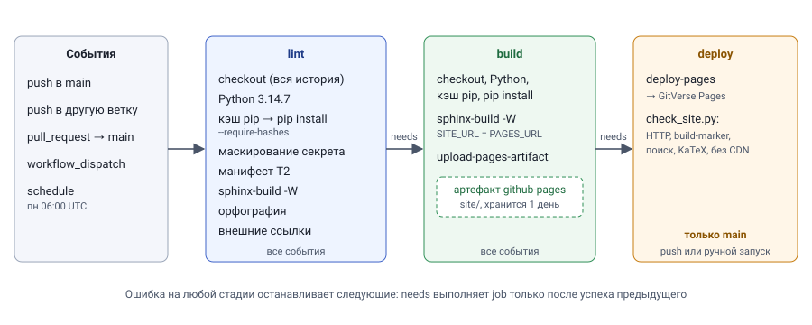

# P1. CI/CD-пайплайн на отечественном сервисе

Пайплайн публикации этого сайта на **GitVerse** — платформе, которую T3 признал самой близкой к
GitHub Actions. Генератор — **Sphinx + MyST**, оптимальный по итогам T1. Чтобы пайплайн строился
именно для него, сайт перед этим переведён с MkDocs на Sphinx (что потребовалось — в «Отладке»).

Файл пайплайна —
[`.gitverse/workflows/site.yml`](https://github.com/crasavella04/python-lab3/blob/main/.gitverse/workflows/site.yml).

:::{admonition} Что ждёт запуска на GitVerse
:class: note

Пайплайн написан, а все его команды проверены локально на этом сайте. Запуск на самой
платформе требует аккаунта и репозитория на GitVerse. Поэтому пункты, которые можно получить
только оттуда, отмечены ниже как **ожидающие запуска**: скриншоты успешного и проваленного
запусков, время сборки с кэшем и без кэша на раннере GitVerse, лог маскирования секрета и
бейдж GitVerse.
:::

## Схема пайплайна



| Стадия | Что делает | Артефакт | Зависит от | Когда выполняется |
|---|---|---|---|---|
| **lint** | установка зависимостей с проверкой хешей; проверка маскирования секрета; проверка манифеста T2; `nox -s site`: расчёт P3 (с кэшем), строгая сборка `sphinx-build -W --keep-going`, орфография; внешние ссылки | — (сборка только для проверки) | — | все события |
| **build** | `nox -s build`: расчёт P3 и сборка под адрес GitVerse Pages (`SITE_URL`), с коммитом в `build-marker` | `github-pages`: каталог `site/` для Pages, хранится 1 день | `lint` | все события |
| **deploy** | публикация артефакта на GitVerse Pages; проверка развёрнутого сайта `check_site.py` | — | `build` | только `main`, `push` или ручной запуск |

`needs` выполняет job только после успеха предыдущей, поэтому ошибка орфографии или битая ссылка
останавливает пайплайн до деплоя. Таймаут каждой job — 15 минут: облачный раннер GitVerse
допускает до 30 (T3), а сборка занимает около минуты, и зависшую задачу лучше прервать раньше.

## События и поведение

| Событие | lint | build | deploy | Зачем |
|---|---|---|---|---|
| `push` в `main` | ✔ | ✔ | ✔ | публикация |
| `push` в любую другую ветку | ✔ | ✔ | — | проверка изменений до слияния: «для остальных веток только сборка» |
| `pull_request` в `main` | ✔ (без проверки маскирования) | ✔ | — | проверка PR; в PR из форков секретов нет (T4), поэтому шаг с секретом пропускается |
| `workflow_dispatch` (вручную) | ✔ | ✔ | ✔ только на `main` | повторная публикация без коммита, например после смены `PAGES_URL` |
| `schedule`, по понедельникам в 06:00 UTC | ✔ | ✔ | — | внешние ссылки «протухают» без коммитов; еженедельная проверка ловит это |

Условие деплоя:

```yaml
if: github.ref == 'refs/heads/main' && (github.event_name == 'push' || github.event_name == 'workflow_dispatch')
```

Расписание исключено из деплоя намеренно: оно проверяет ссылки, а не публикует, и за неделю без
коммитов сайт не изменился.

## Стадия lint

**Строгая сборка.** `sphinx-build -W --keep-going` превращает любое предупреждение в ошибку: битую
внутреннюю ссылку, ссылку на несуществующий якорь, страницу вне оглавления. `--keep-going`
выводит все предупреждения за один прогон, а не только первое.

**Орфография.** `scripts/spellcheck.py` проверяет текст статей в **собранном HTML**: код, формулы и
адреса в проверку не попадают, а текст, вставленный через `{include}`, попадает. Выбор инструмента:

- `pyspellchecker` отклонён. Его русский словарь — 19 880 слов без словоизменения: он не знает даже
  «экспериментами» и «доверительного». К тому же версия 0.9.1 вышла в день проверки.
- Выбран **Hunspell-словарь ru_RU** из LibreOffice (лицензия BSD) через `spylls` — реализацию
  Hunspell на чистом Python. Он знает морфологию и не требует системных библиотек, поэтому
  одинаково работает на раннере и на Windows. Словарь лежит в репозитории (`tools/spelling`, 3,4 МБ),
  и стадия lint не ходит за ним в сеть.

На первом прогоне проверка нашла 145 слов, которых нет в словаре, и все оказались терминами:
«коммит», «раннер», «датасет», «хеш», «ИТМО». Они вынесены в `tools/spelling/wordlist.txt`
(префикс `коммит*` покрывает все словоформы). Опечатку `эксперементе`, внесённую для проверки,
скрипт нашёл. Проверка 11 страниц занимает 2,4 с.

**Внешние ссылки.** Встроенный сборщик `linkcheck`: 41 ссылка, 67 с. Все рабочие, у 8 есть
переадресация. Три ссылки на документацию GitFlic отвечали постоянным редиректом 301 на `/latest/`
и исправлены на новые адреса. Yandex Cloud перенаправляет робота на страницу Яндекс ID — это защита
от ботов, а не ошибка, и сборку она не роняет.

## Кэширование зависимостей

Кэшируется каталог pip `~/.cache/pip` действием `actions/cache@v3` — тем, что приводит
документация GitVerse. Ключ — версия Python и хеш `requirements.txt`:

```yaml
key: pip-${{ runner.os }}-${{ env.PYTHON_VERSION }}-${{ hashFiles('requirements.txt') }}
```

При любом изменении зависимостей ключ меняется, и кэш собирается заново, так что устаревшие
пакеты из кэша не поставятся. Хеши в `requirements.txt` дополнительно гарантируют, что из кэша
ставятся ровно те файлы, которые были зафиксированы.

Замер на этой машине: чистое окружение, установка 38 пакетов с `--require-hashes`.

| Кэш pip | Запуск 1 | Запуск 2 |
|---|---:|---:|
| пустой | 108,6 с | 98,4 с |
| заполненный (23,5 МБ) | 52,9 с | 54,2 с |

С кэшем установка вдвое быстрее: исчезает скачивание с PyPI, остаются распаковка и установка.
Абсолютные цифры на Windows завышены, потому что антивирус проверяет каждый распакованный файл.

**Ожидает запуска на GitVerse:** то же сравнение на облачном раннере. Первый запуск пойдёт без
кэша, второй — с кэшем. Шаг установки печатает в лог своё время и признак попадания в кэш:
`pip install: N с; кэш найден: true`.

## Секреты и маскирование

В репозитории нет ни одного секрета. Шаги получают их только через `${{ secrets.* }}` из
хранилища GitVerse (Настройки → Секреты и переменные), а адрес сайта приходит из обычной
переменной `vars.PAGES_URL`: он не секретный.

Для проверки маскирования заведён отдельный секрет `MASK_CHECK` со случайной строкой. Шаг
намеренно выводит его значение:

```bash
echo "Значение секрета: $MASK_CHECK"     # в логе должно быть ***
echo "Длина значения: ${#MASK_CHECK}"   # длина не маскируется — секрет действительно передан
```

Вторая строка нужна, чтобы отличить «секрет замаскирован» от «секрет пустой»: в обоих случаях
значения в логе не видно, но длина есть только у переданного секрета. Выводить настоящие секреты
так нельзя, поэтому проверка сделана на специальной тестовой строке.

**Ожидает запуска на GitVerse:** скриншот этого шага с `***` вместо значения.

## Воспроизводимость на чистом раннере

| Что зафиксировано | Как |
|---|---|
| Версия Python | `3.14.7` целиком, а не `3.14`: иначе раннер возьмёт последний выпуск ветки |
| Пакеты | `requirements.txt`: 38 пакетов, точные версии и SHA-256 хеши, `pip install --require-hashes` (T4) |
| Словарь орфографии | файлы в репозитории, а не скачивание при сборке |
| KaTeX | файлы в репозитории, без CDN (T4) |
| Даты страниц | `fetch-depth: 0`: без полной истории Git у страниц не будет дат в sitemap |
| Результаты T2 | не пересчитываются, а проверяются по манифесту (T2) |

Сеть стадии сборки нужна только для `pip install` и проверки внешних ссылок.

Проверено локально: в чистое окружение пакеты ставятся из `requirements.txt` с проверкой хешей,
после чего строгая сборка, орфография, проверка манифеста и `check_site.py` проходят без
ошибок.

## Успешный и проваленный запуск

**Ожидает запуска на GitVerse:** скриншот успешного запуска на `main` (lint → build → deploy)
и скриншот проваленного.

Для проваленного запуска подготовлена ветка `p1-fail-demo`. В ней на страницу T2 добавлена
ссылка на несуществующую страницу `results-2025.md`. Ветка не `main`, поэтому должны выполниться
только lint и build, а lint — упасть на строгой сборке. Ожидаемый лог воспроизведён локально:

```text
docs\t2\index.md:14: WARNING: 'myst' cross-reference target not found: 'results-2025.md' [myst.xref_missing]
…
build finished with problems, 1 warning (with warnings treated as errors).
```

Разбор:
- `myst.xref_missing` — MyST не нашёл документ, на который ведёт ссылка;
- `with warnings treated as errors` — сработал ключ `-W`: без него сборка прошла бы с битой ссылкой;
- код выхода 1 останавливает job `lint`, поэтому `build` и `deploy` не запускаются, и сломанный
  сайт не публикуется;
- номер строки (14) отсчитывается **без front matter**: в файле это строка 20. Если искать
  строку по номеру из лога, нужно прибавить длину блока `---…---`.

## Бейдж статуса

В [`README.md`](https://github.com/crasavella04/python-lab3/blob/main/README.md) два бейджа:
GitHub Actions и GitVerse. Адрес бейджа GitVerse:

```text
https://gitverse.ru/api/repos/OWNER/python-lab3/actions/workflows/site.yml/badge.svg?branch=main&lang=ru
```

`?branch=main` показывает статус основной ветки, а не последнего запуска на любой ветке. Без
этого параметра упавшая ветка `p1-fail-demo` «покрасила» бы бейдж в красный. `?lang=ru` выводит
надпись по-русски.

**Ожидает запуска на GitVerse:** вместо `OWNER` — имя владельца репозитория.

## Сравнение с GitHub Actions

Как пайплайн GitVerse соотносится с workflow этого же сайта на GitHub
([`.github/workflows/pages.yml`](https://github.com/crasavella04/python-lab3/blob/main/.github/workflows/pages.yml))
и с прогнозом миграции из T3:

| | GitHub Actions | GitVerse | Прогноз T3 | Факт |
|---|---|---|---|---|
| Файл | `.github/workflows/pages.yml` | `.gitverse/workflows/site.yml` | — | — |
| Синтаксис `on`, `jobs`, `needs`, `if`, `steps` | | без изменений | без изменений | ✔ подтвердилось |
| `secrets.*`, `vars.*`, `github.*` | | без изменений | без изменений | ✔ |
| Python | `actions/setup-python` по SHA, `cache: pip` | `actions/setup-python@v5` + отдельный `actions/cache@v3` | заменить контейнером `python:3.14-slim` | **иначе**: документация GitVerse использует зеркала `actions/*`, поэтому оставлен `setup-python`. Кэш — отдельным действием, чтобы управлять ключом и видеть попадание в лог |
| Закрепление действий | по SHA коммита (T4) | по тегам `@v4`, `@v5`, `@v1.0.0` | — | **отступление от T4**: документация GitVerse приводит только теги; совпадут ли SHA зеркал с GitHub, проверяется первым запуском |
| Pages | `actions/upload-pages-artifact` + `actions/deploy-pages` | те же имена `@v1.0.0`: на GitVerse `actions/*` берутся из зеркала gitverse.ru/actions, там реализации GitVerse | только версия (в T3 ошибочно — `gitverse/…`, такого нет) | ✔ |
| `permissions`, `id-token: write` (OIDC) | есть | убраны | не поддерживается | ✔ |
| `concurrency` | есть | убрана | не поддерживается | ✔ |
| `environment` с URL из выхода `deploy-pages` | есть | адрес из `vars.PAGES_URL` | частично | ✔ |
| `GITHUB_SHA` для `build-marker` | встроенная переменная | задаётся явно: `GITHUB_SHA: ${{ github.sha }}` | переписать | ✔ |
| **Двойной запуск** | — | GitVerse читает и `.github/workflows/` | **не предусмотрено** | **новое**: workflow GitHub на GitVerse запустился бы и упал на шагах Pages. В `pages.yml` у всех трёх job появилось условие `github.server_url == 'https://github.com'` |
| Стадия lint | орфография в job сборки | отдельная job: строгая сборка, орфография, ссылки, маскирование | — | шире, чем на GitHub: этого требует P1 |
| Деплой на Helios | из GitHub (ключ в секретах GitHub) | не переносится | — | один источник деплоя на Helios, чтобы два пайплайна не перезаписывали один каталог |

Итог: прогноз T3 «около часа на перенос» подтвердился по объёму правок. Но два решения T3 не
предвидел. Первое — защита от двойного запуска, потому что GitVerse читает `.github/workflows/`.
Второе — вопрос о закреплении действий по SHA на зеркалах: требование T4 на GitVerse
выполнить не удалось без проверки на платформе. Оба вывода — именно то, что даёт практический
перенос и не даёт чтение документации.
